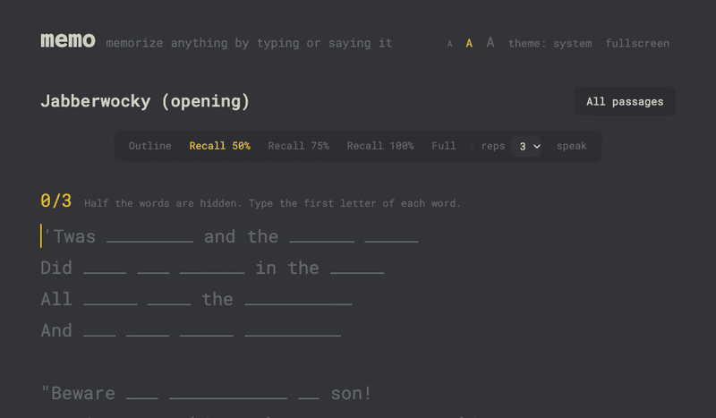

# memo

Memorize a speech, a poem or an interview answer by typing it, or saying it, with fewer and fewer hints.

**[Open memo](https://502john.github.io/memo/)**: free, no account, works offline.



## How it works

1. **Add your text.** Paste anything, keeping its line breaks.
2. **Read it aloud (optional warm-up).** The screen shows the full text, then only first letters, then only the first word of each line.
3. **Practice.** Climb five steps, each with fewer hints:

| Step | You see | You type |
| --- | --- | --- |
| Outline | every word | the first letter of each word |
| Recall 50% / 75% / 100% | fewer and fewer words | the first letter of each word |
| Full | nothing | every word |

Each step needs a few clean runs in a row (3 by default, 1–5). A miss means the run doesn't count. Finish Full and the passage is memorized.

## Features

- **Type or speak.** Press **speak** and say each word. Recognizers mishear, so a spoken word counts if it starts with the same sound. Typing stays exact.
- **Private.** No server, no tracking. Your passages stay in your browser. Export them to back up or switch devices.
- **Works offline** after the first visit, and installs like an app.
- **Your setup:** three text sizes, light/dark theme, fullscreen (`f`).

## Run it yourself

No build step. Clone it and serve the folder:

```sh
python3 -m http.server 8000
# open http://localhost:8000
```

To host your own copy for free, enable GitHub Pages on the repo. Every push to `main` goes live.

## Code

Plain HTML, CSS and JavaScript modules, with no dependencies.

| File | What it does |
| --- | --- |
| `src/state.js` | The rules: steps, runs, scoring. Pure functions. |
| `src/components.js` | The UI, as small functions that return DOM elements. |
| `src/app.js` | The app's one `state` object, the actions that change it, and rendering. |
| `src/match.js` | Whether a spoken word counts. |
| `src/speech.js` | Speech input via the browser's Web Speech API. |
| `src/storage.js` | Saving, export and import. |
| `src/dom.js` | `el()`, the helper every component uses. |
| `sw.js` | Offline caching. |

## Privacy

Memo collects nothing and makes no third-party requests. The one exception is **speak**. Recent Chrome transcribes on your device, so the audio stays on your computer. Other browsers, or Chrome before its language download finishes, send the audio to the browser's speech service (Google, in Chrome). The page shows which one is in use.

## Credits

- Look inspired by [Monkeytype](https://github.com/monkeytypegame/monkeytype)'s "serika" theme (colors and layout only).
- [Roboto Mono](https://github.com/googlefonts/robotomono), under the SIL Open Font License (`fonts/OFL.txt`).
- Sample text: Psalm 23 (King James Version, public domain in the US).

## License

[MIT](LICENSE)
